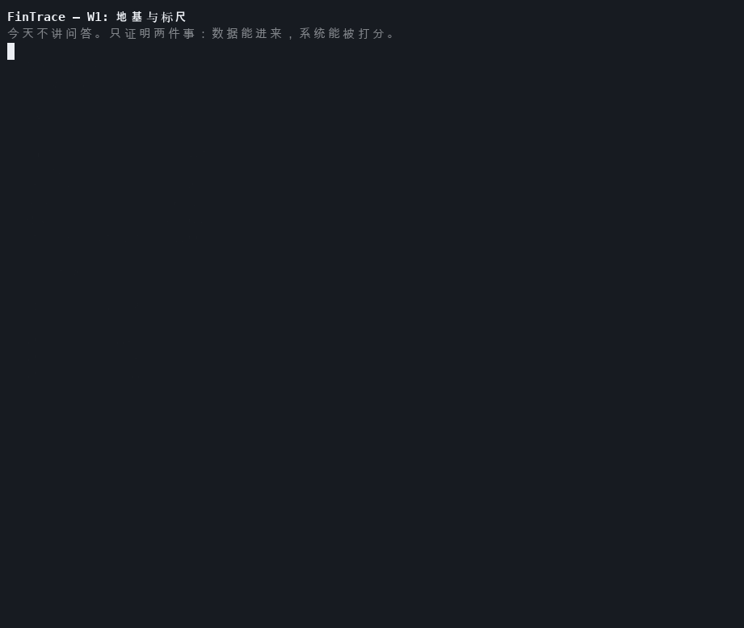

# FinTrace

> 可审计的财报研究代理：**每一句话都有出处，每一个数字都能复算。**

用中文提问，在美国上市公司公开财报里检索、计算、交叉验证，输出带逐句引用的研究简报；
证据不足时明确拒答并说明缺什么。

这不是一个"能聊财报的机器人"。它是一个**带证据链、可评测、可运维**的 Agent 系统，
仓库里最重要的部分不是 Agent 代码，而是**用来证明 Agent 好不好的那套尺子**。

## 状态

| 模块 | 状态 |
|---|---|
| 数据摄取（EDGAR 10-K/10-Q + XBRL） | W1 完成 |
| 评测协议 / NullAgent / 指标 / bootstrap | W1 完成 |
| 金标题（45 题：F2 15、C2 10，其余 5） | W1 起 30 题；W3 扩到 45 |
| 检索（BM25 / dense / RRF / rerank） | W3 实现三档，可显式降级 |
| 引用（结构 → claim 级语义） | W3：数字引 `F#`，正文引 `K#` |
| 语义判官（LLM + 缓存 + 自一致性） | W3 实现；60 条 κ 校准待做 |
| Agent 编排（手写 ReAct） | W2 完成；LangGraph 版 W4 |
| trace 回看 / 离线回放 | W2 完成，W3 记录检索档位与降级原因 |
| MCP 工具服务 | W4 |
| CI（GitHub Actions，含 Postgres service） | W1 完成，W2 加 fixtures 冒烟 |
| 生产化（镜像 / 部署 / 监控） | W5 |

## W3 检索栈（2026-10-30）

`chunk_vectors`（独立表，带模型名）+ 三档检索，缺 key 或缺向量时**显式降级**：

| 档 | 组成 | 用途 |
|---|---|---|
| `bm25` | 词法检索 | 基线；无外部依赖 |
| `hybrid` | BM25 + dense，RRF（k=60） | 跨语言召回 |
| `hybrid_rerank` | hybrid 20 候选 → rerank → 8 | 排序质量 |

```bash
make embed-smoke   # 15 秒验证百炼 embedding（维度/相似度）
make rerank-smoke  # 15 秒验证 rerank（相关段落必须排第一）
make embed         # 回填 2 万 chunk，一次性
RETRIEVAL_TIER=hybrid make eval AGENT=react JUDGE=llm
make ablate        # 三档 × 2 seed 的消融（会写 reports/ablation/）
```

数字引用 `[F#]`、正文引用 `[K#]`：前者用 XBRL fact 做确定性比对，后者用 LLM 判
"这段是否支撑这句话"。见 `docs/adr/ADR-004-fact-citations.md`。

**W3.1 结果**（45 题）：修复"只读 400 字摘要"后，F2 从约 50% 升到 100%（hybrid），
总正确率 77.5% → 95.0%（seed 0）/ 100%（seed 1），配对差异 +17.5pt `[+5.0, +32.5]`。
瓶颈不是召回，是"看到证据却不去读全文"。详见 [docs/w3-report.md](docs/w3-report.md) §7
与 `reports/w3.1/summary.md`。

## W2 基线（2026-10-29）

手写 ReAct + BM25 + XBRL 工具，30 题金标、两次独立运行：

| 指标 | seed 0 | seed 1 |
|---|---|---|
| 答案正确率（20 计分题） | 95.0% | 100% |
| 引用支撑率 | 92.0% | 96.0% |
| 数值准确率 | 90.0% | 100% |
| 拒答召回 / 误拒率 | 100% / 8% | 100% / 4% |
| 单题成本 / p95 延迟 | $0.0010 / 9.2s | $0.0010 / 11.1s |

`FINTRACE_LLM_MODE=replay` 跑完整 30 题可**逐项复现**上述指标（不联网、0 成本）。

**但计分集合是 XBRL 可直接解决的题**：20 道里 15 道有结构化数字。
真正的短板是检索类（F2 多跳）——5 题里 2 题拒答、3 题关键点覆盖 0.48–0.61，实质 0/5。
W3 的重点因此是语义判官 + 混合检索，而不是继续刷总分。详见 `docs/w2-report.md`。

## W1 验收结果（2026-10-27）

| 项 | 结果 |
|---|---|
| 公司 / filing | 10 / 233 |
| section 覆盖率 | 100%（KO 的 10-Q/A 修正案只有单节，属正常） |
| XBRL facts | 85,079 行 |
| chunks（朴素切块） | 20,373 |
| 金标题 | 30 题（6 类 × 5），15 道数值题与 XBRL 逐条对账 |
| 对抗语料 | 5 份合成文档：注入 / 单位陷阱 / 重述时点 / 实体混淆 |
| NullAgent 基线 | 正确率 0%、引用支撑 0%、误拒率 100%——与预期一致，说明尺子本身没坏 |

## 演示



20 秒真实终端录制（`agg` 压掉了等待时间）：`make stats` → `make ingest`（幂等跳过）
→ `make q-check`（30 题 + XBRL 对账）→ `make eval`（零基线）。
可重录：`bash demo/record.sh`。

## 持续集成

[](https://github.com/evinyang-zw/fintrace/actions/workflows/ci.yml)

`.github/workflows/ci.yml`：ruff → mypy → pytest（带 pgvector service）→ eval smoke。
冷启动 32 秒，全绿。

## 快速开始

```bash
uv sync                 # 安装依赖
make up                 # 启动 Postgres（pgvector）
make universe           # ticker -> CIK（不手抄十位数字）
make stats              # 仓库存量：filing/section/facts/覆盖率
make ingest             # 抓取并入库（首次约 10 分钟，之后走本地快照）
make ingest-fixtures    # 对抗语料入库（A1 五题的前置）
make q-check            # 校验金标题（含数值对账）
make ask Q="苹果 FY2024 总营收？" UNIVERSE=AAPL   # 单题调试，打印 trace
make eval AGENT=react               # 跑基线（默认 deterministic 判官）
make trace              # Streamlit 回看某次运行（引用可高亮原文）
make test               # 单元测试（含 3 题离线回放；不联网）
```

环境变量见 `.env.example`。SEC 要求请求头里带可联系的 User-Agent。

> 国内网络拉不到 Docker Hub 时，可先 `docker pull <mirror>/pgvector/pgvector:pg17`
> 再 `docker tag` 成本地镜像；`docker-compose.yml` 本身不需要改。

## 结构

```
pipelines/            离线摄取：EDGAR -> 纯文本 -> section/chunk -> Postgres
  sources/            DataSource 协议 + EDGAR 实现（A 股 adapter 从这里插入）
  fixtures.py         对抗语料入库（与真实语料同一套解析器）
agent/                手写 ReAct：llm / tools / prompts / react / trace / pricing
eval/                 评测：问题 schema、agent/judge 协议、指标、确定性判分、报告
  agents/null.py      永远拒答的 NullAgent（用来验尺子，不是用来答题）
web/trace_app.py      Streamlit 回看页：时间线 + 引用高亮
tests/                单元测试 + 契约测试（CI 不联网）
```

关键设计取舍记录在 `docs/adr/`，指标口径见 `docs/metrics.md`。

## 三条不可让步的规则

1. **数字不经过 LLM**：所有财务数字来自 XBRL，正文只负责定性叙述。
2. **引用到字符区间**：引用不是"某份文档"，而是 `(accession, item, char_start, char_end)`。
3. **评测先行**：没有基线分数之前，不写 Agent。
